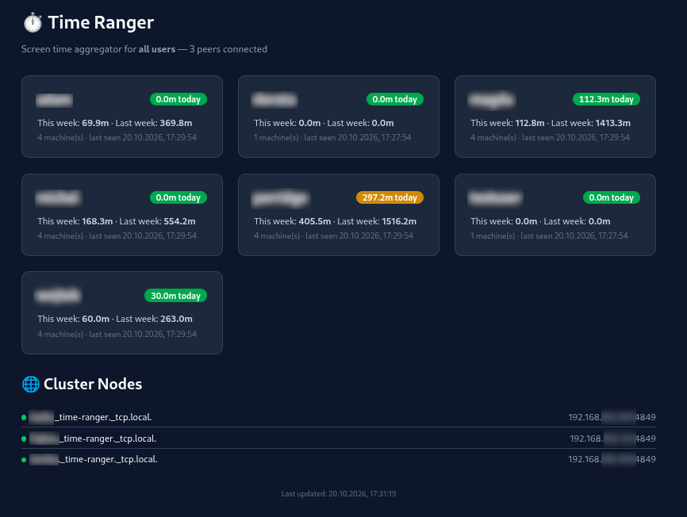

# Time Ranger

A distributed screen time aggregator that runs as a service across multiple
Linux systems on a LAN. Discovers peers via mDNS, tracks screen time using
[timekpr-next](https://github.com/nol13/timekpr-next), gossips state between
nodes, and serves a real-time dashboard.



## Features

- **Peer Discovery**: mDNS (DNS-SD) service advertisement on `_time-ranger._tcp`
- **Screen Time Tracking**: Queries `timekpra --userinfo` for each group member
- **Gossip Protocol**: Anti-entropy synchronization every 30s
- **Web Dashboard**: Auto-refreshing dark-themed UI with per-user & per-node stats
- **Persistent Storage**: Daily flat files survive daemon restarts

## Requirements

- Go 1.25+
- `timekpr-next` (provides `timekpra` CLI)
- Linux with mDNS support

## Quick Start

```bash
# Build
go build .

# Run
./time-ranger
```

## Configuration (environment variables)

| Variable | Default | Description |
|----------|---------|-------------|
| `TIME_RANGER_GROUP` | `` | Unix group to monitor. If empty, first ten seemingly non-system users from `getent passwd`. |
| `TIME_RANGER_UI_PORT` | `4848` | HTTP port for dashboard (listening on localhost only). |
| `TIME_RANGER_PEER_PORT` | `4849` | Port for peer communication/gossip (publicly accessible, protected with mTLS, disabled by default). |
| `TIME_RANGER_CA` | `` | Path to CA cert/key PEM file(s), comma separated. When provided, peer port is enabled with mTLS. |
| `TIME_RANGER_DATA` | `.` | Data directory |

## Dashboard

Open `http://localhost:4848` in your browser.

## License

Time Ranger, a distributed screen time aggregator.
Copyright (C) 2026 Marcin Owsiany <marcin@owsiany.pl>

This program is free software: you can redistribute it and/or modify
it under the terms of the GNU General Public License as published by
the Free Software Foundation, either version 3 of the License, or
(at your option) any later version.

This program is distributed in the hope that it will be useful,
but WITHOUT ANY WARRANTY; without even the implied warranty of
MERCHANTABILITY or FITNESS FOR A PARTICULAR PURPOSE.  See the
GNU General Public License for more details.

You should have received a copy of the GNU General Public License
along with this program.  If not, see <https://www.gnu.org/licenses/>.
